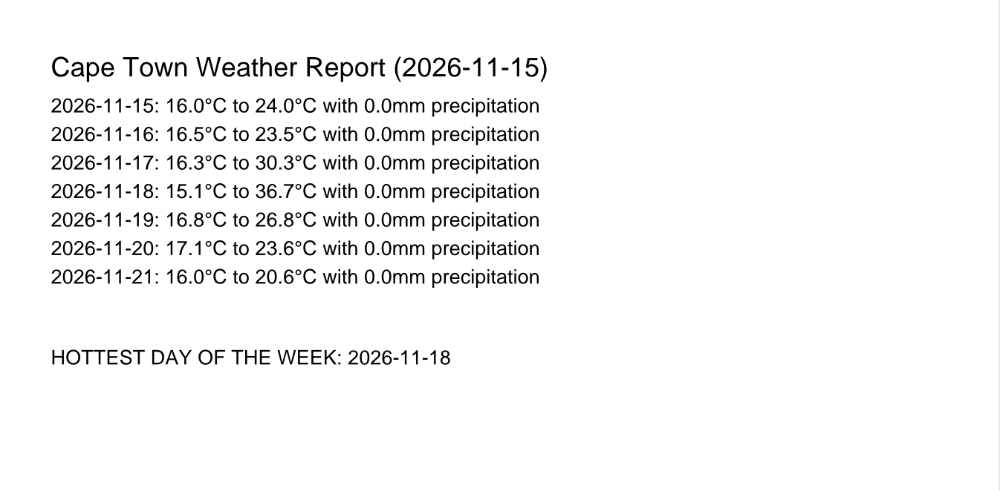

# Weather Report Generator

A Python script that fetches a 7-day weather forecast for Cape Town, builds a PDF summary, and emails it automatically.

## What it does


1. Pulls the forecast (daily highs, lows and rainfall) from the free [Open-Meteo API](https://open-meteo.com/).
2. Generates a formatted PDF report, including the hottest day of the week.
3. Emails the PDF as an attachment via Gmail.

Failed requests (no internet, timeouts, bad responses) and email login problems are caught and print clear messages instead of crashing.

## Requirements

- Python 3.9+
- A Gmail account with 2-Step Verification and an [app password](https://myaccount.google.com/apppasswords)

## Setup

1. Install the dependencies:
   ```
   pip install requests fpdf2
   ```
2. Copy `config_example.py` to `config.py` and fill in your details:
   ```python
   EMAIL = "you@gmail.com"
   appPassword = "your-16-character-app-password"
   ```
   `config.py` is listed in `.gitignore` and should never be committed.

## Usage

```
python weather_report.py
```

The report is saved as `report.pdf` and emailed to the address in `config.py`.

## How it works

| Function | Job |
| --- | --- |
| `get_forecast()` | Calls the Open-Meteo API and returns the parsed JSON |
| `build_pdf(data, path)` | Builds the PDF report from the forecast data |
| `send_email(path)` | Attaches the PDF and sends it through Gmail's SMTP server |

## Customising

- **Different city:** change `latitude` and `longitude` in `get_forecast()`.
- **Different recipient:** change the `To` field in `send_email()`.

## Built with

Python, `requests`, `fpdf2`, `smtplib`
